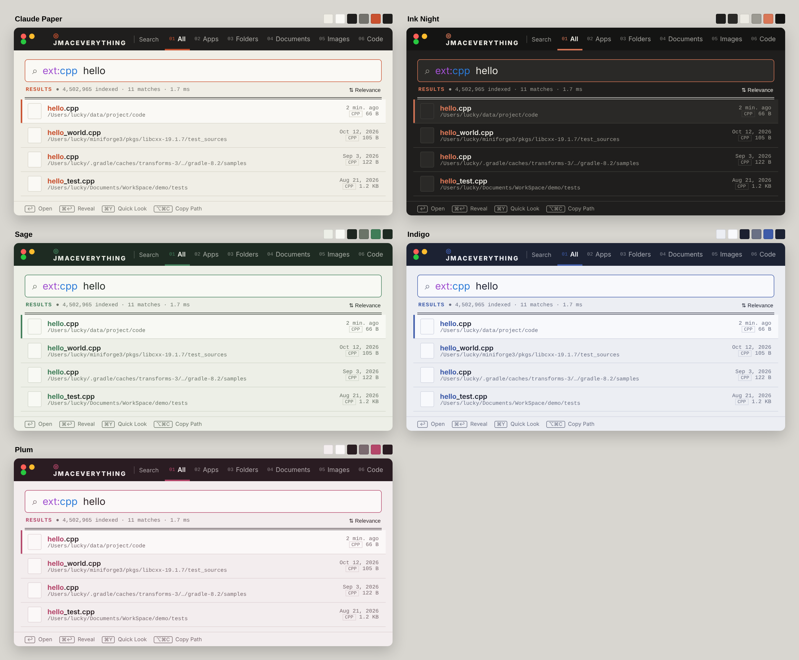

# JMacEverything — fork changes

Fork of [joshua-wu/MacEverything](https://github.com/joshua-wu/MacEverything) (MIT). The search engine is unchanged; this fork reworks the UI and adds workflow features.

## Look & feel
- Translucent window with hidden title bar (Spotlight/Raycast style) instead of the heavy blue-bordered search box
- Smaller, calmer search field (22pt), options moved into a slider menu next to the field
- Rows: 32px icons, middle-truncated paths, modified date, kind tag and size on the right
- Real selection highlight; friendly empty states; compact status footer with keyboard hints

## 1.4 — AutoCoder-style theme and color cards
- Dark top bar with the JMACEVERYTHING wordmark and numbered type tabs (`01 All … 09 Archives`, ⌘1–⌘9)
- Warm paper background, bordered search field, monospaced status strip, heavy double rule, list rows with hairlines and an accent bar on the selected row
- Five color cards, switchable from the palette icon in the top bar (remembered between launches): **Claude Paper** (default), **Ink Night** (dark), **Sage**, **Indigo**, **Plum**

## 1.11 — Four languages and a menu-bar control panel
- **Languages**: 简体中文 · 繁體中文 · English · 日本語, following the system by default; switch any time from the options menu or the menu-bar panel, no restart. Covers the main window, menus, context menus, start panel, settings windows and syntax-help section titles (syntax examples stay as typed).
- **Menu-bar icon**: left click shows/hides the window; right click (or ⌃-click) opens a control panel in the Claude Paper style — live status (files indexed, memory), show/hide with your hotkey, rebuild index, settings, launch at login, keep running in the menu bar, MCP integrations, color cards and language, and Quit.

## 1.10 — Always in the menu bar
- Closing the window, ⌘Q and the Dock's "Quit" now only hide JMacEverything; it keeps indexing in the menu bar and the hotkey (⌥Space) brings it back instantly
- Only **Quit JMacEverything** in the menu-bar icon's menu really quits (logout, restart and shutdown still quit normally)
- Toggle **Keep Running in Menu Bar** in that menu to restore the old behaviour; clicking the Dock icon reopens the window

## 1.9 — Memory diet
- `pathIndex_` (full path → record) stored every full path a second time as a `std::string` key: ~0.5 GB for 2.5M files. It now keeps only a 64-bit hash per file in an open-addressed table (`Core/PathIndexMap.h`), ~65 MB. Prefix deletes rebuild the path from the existing pools. Verified against the old engine with a randomized add/remove/update/prefix-rescan/compaction test (ASan clean, identical results).
- Trigram / path / extension posting lists drop their growth slack after building (~85 MB+ on large disks).
- Memory freed after the initial scan, index load and content indexing is handed back to macOS (`malloc_zone_pressure_relief`), instead of staying in the process footprint.
- Footer shows the app's current memory (same number as Activity Monitor).
- The upstream C++ test suite never compiled in CI (missing abseil include path). Fixed; all ~12,000 engine checks pass on macOS with the new map, and CI now blocks releases on test failures.

## 1.8 — grep inside files (ideas from [fsearch](https://github.com/noahdunnagan/fsearch))
- `grep:` / `infile:` / `content:` can appear **anywhere** and combine with any filter: `ext:swift grep:TODO`, `path:Projects grep:"open file"`
- Shows **every matching line with its line number** (up to 20 per file), grouped by file; lines are read fresh from disk
- **Smart case**: case-insensitive unless the pattern has a capital letter
- **Regex inside files**: `inre:pattern` (needs a name filter such as `ext:` or `path:` to pick the files)
- Files you filter by name are read directly even if their type isn't in the content index
- ↩ / double-click **opens the file at that line** in Cursor, VS Code or Zed (otherwise the default app); right-click to copy `path:line` or the line
- **In Content…** quick chip (⌃⌥C) and an "Add Common Text & Code Types" button in Content Settings

## 1.7 — Calmer start, tighter header, easier install
- Empty query shows a start panel (recent searches you can re-run or remove, plus example queries) instead of a list of system cache files; the old "recently modified files" view is still available in the options menu
- Header sits on the same row as the traffic lights, closer to the left edge, so more type tabs fit
- DMG contains an **Applications** shortcut: open it and drag JMacEverything across

## 1.6 — Own name and icon
- The app is now **JMacEverything.app** (window title, menu-bar items, DMG volume and files)
- New icon: terracotta magnifier with a cream "J" on warm ink, matching the Claude Paper palette
- Bundle ID stays `com.maceverything.app`, so the existing index cache and settings keep working

## Quick query (Everything syntax without typing it)
- A **QUICK** chip row under the search field: Today · This Week · Last Month · > 100 MB · > 1 GB · In Path… · Extension… · Exclude… · OR. Complete filters toggle on/off (highlighted when active); partial ones insert the prefix and leave the caret ready to type.
- **Query** menu with ⌃⌥ shortcuts: ⌃⌥T today, ⌃⌥W this week, ⌃⌥M last month, ⌃⌥B > 100 MB, ⌃⌥G > 1 GB, ⌃⌥F files only, ⌃⌥D folders only, ⌃⌥P `path:`, ⌃⌥E `ext:`, ⌃⌥X exclude `!`, ⌃⌥O OR `|`, ⌃⌥R `regex:`
- Existing helpers still apply: Tab accepts the grey auto-complete (`ex` → `ext:`), ⇧⌘/ opens the full syntax reference.

## New features
| Feature | How |
|---|---|
| Keyboard navigation | ↑ ↓, Page Up/Down; ↩ open, ⌘↩ reveal in Finder |
| Quick Look | ⌘Y on the selected result, or right-click → Quick Look |
| Copy path | ⌥⌘C |
| Esc | clears the query; on an empty query it hides the window |
| Type filter chips | All / Apps / Folders / Documents / Images / Video / Audio / Code / Archives (also ⌘0–⌘8 via the Filter menu) |
| Sort | Relevance, Name, Date Modified, Size, Kind; ascending/descending (sorts the loaded results) |
| Richer context menu | Open With…, Open in Terminal, Copy Name, Copy Parent Folder, Move to Trash (recoverable) |

## Files touched
`App/ContentView.swift` (rewritten), `App/ResultRow.swift`, `App/ContentResultRow.swift`, `App/SearchOptions.swift`, `App/HighlightedSearchField.swift`, `App/MacEverythingApp.swift`. No new files were added, so the Xcode project needs no changes.

## Release
Bump `CFBundleShortVersionString` (and `CFBundleVersion`) in `MacEverything/Info.plist` and push to `main`: CI builds, tags `vX.Y.Z` and publishes the release with zip, dmg and SHA256SUMS. Builds are ad-hoc signed (not notarized): first launch needs right-click → Open.

## Build
Open `MacEverything.xcodeproj` in Xcode (macOS 14+, `brew install re2`), choose your signing team, ⌘R.
